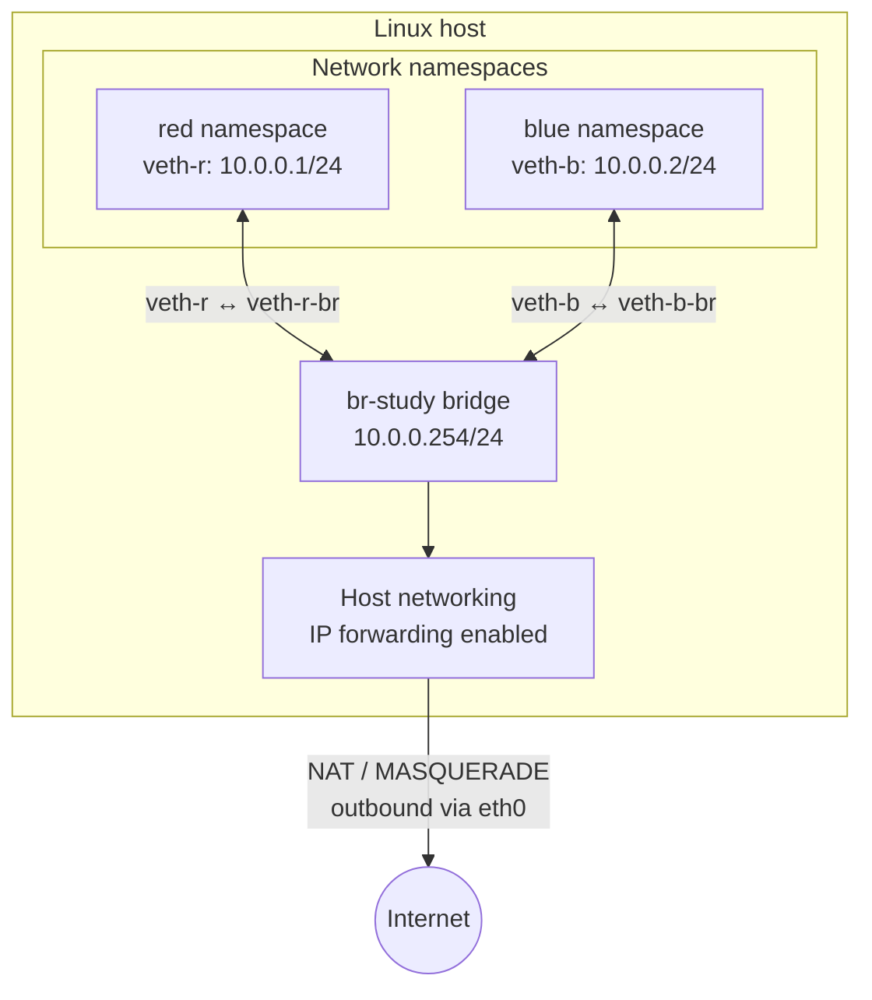

# Docker Networking: Linux Under the Hood

**Status:** Completed  
**Completed:** 16 October 2026  
**Validation:** 20/20 automated tests passed  
**Environment:** Ubuntu VM running through OrbStack

## What I built

I inspected Docker’s default bridge network and then recreated the same underlying network model manually using Linux network namespaces, virtual Ethernet pairs and a Linux bridge.

The completed manual network contained:

- two isolated network namespaces: `red` and `blue`;
- one Linux bridge: `br-study`;
- one veth pair connecting each namespace to the bridge;
- a default route from each namespace through the bridge;
- host IP forwarding;
- forwarding and NAT masquerade rules for internet access.

## Architecture



I also created a more detailed command map while working through the exercise:

[View the full manual network build diagram](manual-network-build.png)

The detailed diagram records the commands and test results, while the Mermaid diagram above provides a clearer high-level view of the finished network.

## Exercise 1: Inspecting Docker networking

Docker’s default bridge used:

```text
Bridge address: 172.17.0.1
Bridge subnet:  172.17.0.0/16
```

The two host-side veth interfaces attached to `docker0` were:

```text
15: vethf8ac826@if2 ... master docker0 state UP ... link-netnsid 3
16: veth0d40f4f@if2 ... master docker0 state UP ... link-netnsid 4
```

Both interfaces were operational and attached to the `docker0` bridge.

### What is the relationship between `docker0` and the default gateway?

The `docker0` interface is the host-side Linux bridge and has the address `172.17.0.1`. Containers connected to Docker’s default bridge use that address as their default gateway.

The bridge provides Layer 2 connectivity between attached containers. The Linux host handles routing when traffic needs to leave the bridge network.

### How did I match each container to its host-side veth?

Inside `c1`, `ip addr` showed:

```text
2: eth0@if15
    inet 172.17.0.2/16
```

The `@if15` portion means that the peer of the container’s `eth0` has interface index `15`.

On the host, interface index `15` was:

```text
15: vethf8ac826@if2
```

This established the following mapping:

| Container | Container interface | Container address | Host interface |
|---|---|---:|---|
| `c1` | `eth0@if15` | `172.17.0.2/16` | `vethf8ac826` |
| `c2` | `eth0@if16` | `172.17.0.3/16` | `veth0d40f4f` |

The container sees its end of the veth pair as `eth0`. The generated `veth...` interface exists in the host network namespace and is attached to `docker0`.

The veth names are dynamically generated by Docker, so they may change when containers are recreated.

## Exercise 2: Building the network manually

I created the `red` and `blue` network namespaces and connected them to `br-study` using veth pairs.

Successful checks included:

```text
red  -> blue:         successful
blue -> red:          successful
red  -> br-study:     successful
red  -> 127.0.0.1:   failed before lo was enabled
red  -> 127.0.0.1:   successful after lo was enabled
```

### Why did loopback initially fail?

Every network namespace receives an independent network stack, including its own loopback interface. In a newly created namespace, `lo` exists but starts administratively down.

Communication between `red` and `blue` still worked because it used the namespace veth interfaces and the `br-study` bridge. That traffic did not depend on the loopback interface.

This demonstrated that loopback is local to its namespace and separate from bridge-connected interfaces.

### What did `ip link show master br-study` show?

It listed the host-side ends of the veth pairs attached to `br-study`:

- `veth-r-br`, paired with `veth-r` inside `red`;
- `veth-b-br`, paired with `veth-b` inside `blue`.

The output also showed their interface indexes, operational state, MTU and bridge membership. Seeing both host-side interfaces associated with `master br-study` confirmed that they were ports on the bridge.

### How did this differ from Docker?

The Linux primitives were essentially the same:

- network namespaces;
- veth pairs;
- a Linux bridge;
- IP addresses and routes;
- IP forwarding;
- firewall and NAT rules.

The difference was automation. Docker normally creates, configures and removes these resources automatically. It also handles address allocation, container lifecycle, network isolation and supporting network rules.

Building the network manually exposed what Docker usually does on my behalf.

## Exercise 3: Internet access and NAT

I identified the host’s default route with:

```bash
ip route show default
```

The result was:

```text
default via 192.168.139.1 dev eth0 proto dhcp src 192.168.139.35 metric 100
```

This showed:

| Property | Value |
|---|---|
| Outbound interface | `eth0` |
| Default gateway | `192.168.139.1` |
| Host source address | `192.168.139.35` |
| Route source | DHCP |
| Route metric | `100` |

I therefore used `eth0` as the outbound interface in the masquerade rule.

After adding namespace default routes, enabling forwarding and configuring the forwarding and masquerade rules, both namespaces reached external IP addresses:

```text
red  -> 8.8.8.8: successful
blue -> 1.1.1.1: successful
```

### What does masquerade do?

The namespaces use private addresses from `10.0.0.0/24`. Those addresses are not directly routable on the external network.

The masquerade rule rewrites the source address of an outbound packet to the address of the host’s `eth0` interface. Connection tracking records the translation and reverses it when the reply returns, allowing the response to reach the correct namespace.

In this environment, traffic left through `eth0` using the host address `192.168.139.35`.

### Why is IP forwarding required?

Without IP forwarding, the host processes packets addressed to itself but does not route packets between `br-study` and `eth0`.

Enabling forwarding allows the Linux host to operate as a router between the namespace network and its external network.

### Why did Docker’s forwarding policy affect this network?

Docker configures firewall rules to isolate and control traffic involving its networks. Traffic that has not been explicitly permitted can be blocked by the forwarding policy.

My manually created `br-study` network was not automatically included in Docker’s permitted flows, so I added explicit rules allowing traffic entering and leaving that bridge.

### Docker’s corresponding NAT rule

Docker had its own masquerade rule covering the default bridge subnet:

```text
172.17.0.0/16
```

This performs the same general function for Docker containers that my `10.0.0.0/24` masquerade rule performed for the manual namespaces.

## Exercise 4: Bridge-down investigation

### Symptom

After setting `br-study` down, traffic between `red` and `blue` stopped.

### Investigation

I checked:

1. the operational state of `br-study`;
2. whether the host-side veth interfaces still existed;
3. whether those interfaces were still attached to the bridge;
4. whether the namespace addresses and routes were still present.

The veth pairs remained configured, but the bridge was down. This isolated the fault to the shared Layer 2 forwarding component rather than the namespace interfaces.

### Fix

I brought the bridge back up:

```bash
sudo ip link set br-study up
```

I then repeated the namespace ping test and confirmed that connectivity had been restored.

## Exercise 5: Missing-masquerade investigation

### Symptom

After removing the masquerade rule:

- namespace-to-namespace traffic continued working;
- namespace-to-bridge traffic continued working;
- internet traffic failed.

### Explanation

Local communication stayed inside `10.0.0.0/24` and crossed the Linux bridge, so it did not require address translation.

Without masquerading, external packets left with a source address such as `10.0.0.1`. The external network did not have a route back to that private namespace address.

The masquerade rule replaced the private source address with the host’s outbound address. Connection tracking then used the recorded translation to direct replies back to the correct namespace.

### Fix

I restored the masquerade rule using `eth0` as the outbound interface and confirmed that both namespaces could once again reach external addresses.

## Automated validation

I ran:

```bash
uv run --project ../../.. --group test pytest tests/ -v
```

Result:

```text
20 passed in 0.47s
```

The complete output is available in [test-results.txt](test-results.txt).

The tests verified:

- Docker availability;
- the default Docker bridge;
- both network namespaces;
- the `br-study` bridge;
- veth attachment and addressing;
- bidirectional namespace connectivity;
- bridge gateway connectivity;
- host IP forwarding;
- forwarding rules;
- the masquerade rule;
- namespace default routes.

## What I learned

Container networking is built from standard Linux networking components rather than a networking system unique to Docker.

The most useful part of this exercise was creating those components manually. It connected Docker concepts such as bridge networks and container interfaces to the underlying namespaces, veth pairs, routes, forwarding rules and NAT configuration.

It also gave me a repeatable troubleshooting order:

1. check interface state;
2. check addressing;
3. check bridge attachment;
4. check routes;
5. check IP forwarding;
6. check firewall and NAT rules;
7. test one network boundary at a time.
