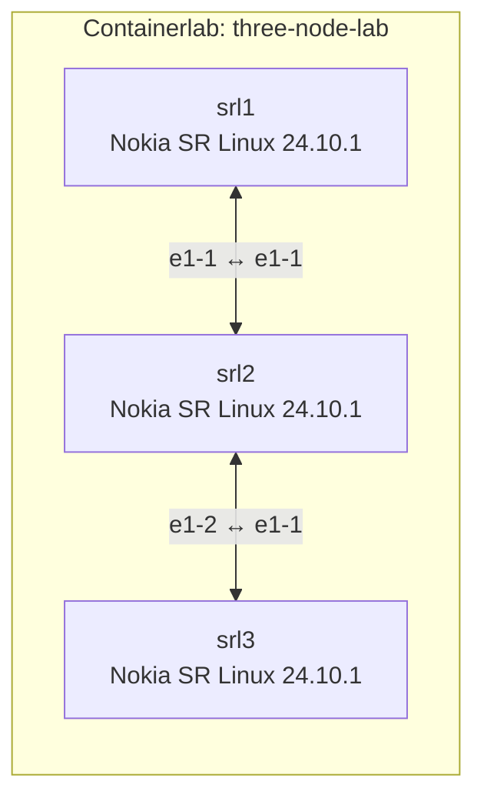
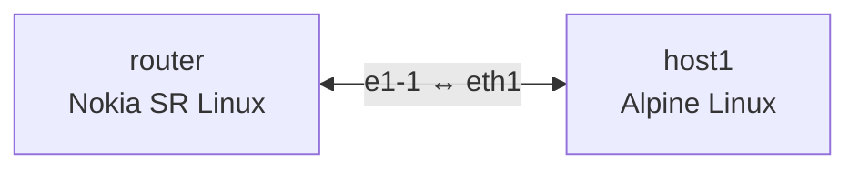

# Containerlab Primer: Topologies and Break/Fix Troubleshooting

**Status:** Completed  
**Completed:** 31 October 2026  
**Validation:** 18/18 automated tests passed  
**Environment:** Ubuntu VM running through OrbStack

## What I built

I used Containerlab to deploy and troubleshoot container-based network topologies running Nokia SR Linux and Alpine Linux.

The work included:

- deploying a two-node SR Linux topology;
- inspecting nodes and interfaces through the SR Linux CLI;
- building a three-node linear topology;
- viewing a running topology through Containerlab’s graph interface;
- exporting inspection data as JSON;
- connecting an SR Linux router to an Alpine Linux host;
- diagnosing a stopped network node;
- diagnosing and repairing a missing topology link;
- validating the lesson with 18 automated tests.

## Three-node architecture



The middle node used two data-plane interfaces:

| Node | Interface | Connected to |
|---|---|---|
| `srl1` | `e1-1` | `srl2:e1-1` |
| `srl2` | `e1-1` | `srl1:e1-1` |
| `srl2` | `e1-2` | `srl3:e1-1` |
| `srl3` | `e1-1` | `srl2:e1-2` |

The rendered Containerlab topology is available in [3n-topology.png](./3n-topology.png).

## Topology discovery

When `clab deploy` is run without `-t`, Containerlab searches the current directory for a topology matching `*.clab.yml` or `*.clab.yaml`.

This shorthand works when exactly one matching topology is present. When several topology files exist, I explicitly select one:

```bash
clab deploy -t three-node.clab.yml
```

## Exercise 1: Deploying the first lab

The initial topology contained two Nokia SR Linux nodes joined by one data-plane link:

```yaml
name: first-lab

topology:
  nodes:
    srl1:
      kind: srl
      image: ghcr.io/nokia/srlinux:24.10.1

    srl2:
      kind: srl
      image: ghcr.io/nokia/srlinux:24.10.1

  links:
    - endpoints: ["srl1:e1-1", "srl2:e1-1"]
```

I deployed and inspected the lab:

```bash
clab deploy
clab inspect
```

Containerlab created:

- two SR Linux containers;
- a management connection for each node;
- one data-plane link between `ethernet-1/1` on each node;
- generated configuration and supporting lab files.

## Exercise 2: Inspecting SR Linux

I opened an SR Linux CLI session through the container:

```bash
docker exec -it clab-first-lab-srl1 sr_cli
```

I inspected:

```text
show version
show interface brief
show system application
```

The commands confirmed:

- the expected SR Linux version was running;
- `ethernet-1/1` was administratively enabled and operationally up;
- the SR Linux system applications were running.

Containerlab automatically includes `admin-state enable` in its default SR Linux configuration for interfaces referenced in the topology’s `links` section.

### Local troubleshooting versus production access

`docker exec` is useful in this lab because it provides direct local access to the container. It is primarily a development and troubleshooting method.

For a remotely managed network device, more representative access methods include:

- SSH for interactive administration;
- NETCONF for structured configuration using XML RPCs;
- gNMI for structured configuration, state retrieval and streaming telemetry;
- automation tools such as Ansible or gNMIc.

## Exercise 3: Building a three-node topology

I created a linear topology:

```text
srl1 ─── srl2 ─── srl3
```

The topology used:

```yaml
links:
  - endpoints: ["srl1:e1-1", "srl2:e1-1"]
  - endpoints: ["srl2:e1-2", "srl3:e1-1"]
```

After deployment, I confirmed that all three containers were running:

```bash
clab inspect -t three-node.clab.yml
```

On `srl2`, both required interfaces were enabled and operationally up:

```bash
docker exec -it clab-three-node-lab-srl2 \
  sr_cli -c "show interface brief"
```

This demonstrated that one node can participate in multiple links by assigning a different interface to each connection.

## Visualising the topology

The exercise provided:

```bash
containerlab graph \
  -t exercises/three-node.clab.yml \
  -o exercises/topology.png
```

In my installed Containerlab version, this did not write a PNG. Instead, the graph command started its web interface on port `50080`.

Because Containerlab was running inside an OrbStack VM, I opened:

```text
http://jlabs.orb.local:50080/
```

I captured the rendered topology and saved it as [3n-topology.png](./3n-topology.png).

Containerlab can also generate Mermaid, Graphviz DOT and Draw.io representations.

## Inspecting the lab as JSON

I exported Containerlab’s inspection output as JSON:

```bash
clab inspect \
  -t three-node.clab.yml \
  --format json > 3n-lab-info.json
```

The result is available in [3n-lab-info.json](./3n-lab-info.json).

This file describes the deployed lab and its containers in a machine-readable format. It is inspection output, not an SR Linux startup configuration.

An SR Linux startup configuration must instead be either:

- a complete SR Linux `config.json`; or
- a partial SR Linux CLI configuration.

Containerlab can persist a running SR Linux configuration with:

```bash
containerlab save -t <topology-file>
```

## Exercise 4: Documentation research

I reviewed the Containerlab documentation for Nokia SR Linux and investigated:

- default and user-defined startup configurations;
- full JSON and partial CLI configuration formats;
- saving running configurations;
- license file configuration;
- local and remote configuration sources.

I also reviewed the [`sflow-rt/containerlab`](https://github.com/sflow-rt/containerlab) project, which demonstrates network telemetry and DDoS detection using Containerlab-based data-centre topologies.

## Exercise 5: Adding a Linux host

I built a mixed topology containing:

- one Nokia SR Linux node named `router`;
- one Alpine Linux node named `host1`;
- one link from `router:e1-1` to `host1:eth1`.



The topology definition was:

```yaml
name: mixed-lab

topology:
  nodes:
    router:
      kind: srl
      image: ghcr.io/nokia/srlinux:24.10.1

    host1:
      kind: linux
      image: alpine:3.20

  links:
    - endpoints: ["router:e1-1", "host1:eth1"]
```

I entered the Alpine container with:

```bash
docker exec -it clab-mixed-lab-host1 sh
```

I then inspected its data-plane interface:

```bash
ip addr show eth1
```

The `UP,LOWER_UP` flags confirmed that:

- `eth1` existed;
- the interface was administratively up;
- the virtual link had an operational peer.

The interface only had an IPv6 link-local address. Therefore, this test proved Layer 2 link state, not IPv4 connectivity.

To prove IPv4 connectivity, both link endpoints would first need IPv4 addresses. I could then verify:

```bash
ip -4 addr show dev eth1
ip route
ping -c 3 <peer-ipv4-address>
```

## Exercise 6: Break/fix — stopped container

I deliberately stopped the second node:

```bash
docker stop clab-first-lab-srl2
```

The symptoms were:

- `docker exec` failed because the container was not running;
- `docker ps -a` showed the container as exited;
- `clab inspect` reported that `srl2` was no longer running.

I repaired the lab with:

```bash
docker start clab-first-lab-srl2
```

A complete redeployment was not required because the container had only been stopped, not removed. Starting it resumed the same container and its existing lab state.

The topology’s `links:` section was not rerun by `docker start`. Containerlab had created the link during the original deployment, and the existing node and lab state were retained.

After starting the node, I verified:

```bash
clab inspect -t topology/lab.clab.yml

docker exec -it clab-first-lab-srl2 \
  sr_cli -c "show interface brief"
```

The node returned to a running state and its linked interface became operational again.

## Exercise 7: Break/fix — missing link

I created a deliberately broken topology:

```yaml
name: broken-lab

topology:
  nodes:
    srl1:
      kind: srl
      image: ghcr.io/nokia/srlinux:24.10.1

    srl2:
      kind: srl
      image: ghcr.io/nokia/srlinux:24.10.1

  links: []
```

Both node containers were running, but no data-plane veth connection existed between them.

This demonstrated an important distinction:

| State | Meaning |
|---|---|
| Node running | The container and network operating system are running |
| Interface enabled | The interface is administratively allowed to operate |
| Interface operationally up | The interface detects a working link to its peer |
| Data-plane connectivity | Correct links, addressing and routes allow traffic to pass |

The nodes remained connected to Containerlab’s management network, but they did not have the intended private data-plane link.

I repaired the topology by adding:

```yaml
links:
  - endpoints: ["srl1:e1-1", "srl2:e1-1"]
```

I then destroyed and cleanly redeployed the lab:

```bash
clab destroy \
  -t broken-topology.clab.yml \
  --cleanup

clab deploy \
  -t broken-topology.clab.yml
```

During deployment, Containerlab reported:

```text
Created link: srl1:e1-1 ▪┄┄▪ srl2:e1-1
```

After SR Linux finished booting, `ethernet-1/1` on both nodes was administratively enabled and operationally up.

The nodes were previously running without the link because container state and interface state describe different layers of the system.

## Automated validation

I ran:

```bash
uv run \
  --project ../../.. \
  --group test \
  pytest tests/ -v
```

Result:

```text
18 passed in 79.16s
```

The tests validated:

- Containerlab installation;
- Docker availability;
- topology file existence;
- valid YAML;
- required topology name;
- node definitions;
- node kinds and images;
- link definitions and endpoints;
- absence of unpinned `latest` image tags;
- successful lab deployment;
- running containers after deployment;
- valid inspection output;
- successful lab destruction;
- existence and validity of the exercise solution files.

The complete test result is available in [clab-primer-tests.png](./clab-primer-tests.png).

## Generated lab directories

Containerlab creates runtime directories named after each lab, for example:

```text
clab-mixed-lab/
clab-three-node-lab/
```

These directories can contain:

- generated inventories;
- node configuration;
- authorised keys;
- topology state;
- TLS material;
- other runtime artefacts.

They are generated state rather than authored evidence and are excluded with:

```gitignore
clab-*/
```

Labs should be destroyed with `--cleanup` before removing any remaining generated directories.

## Evidence

| File | Purpose |
|---|---|
| [`three-node.clab.yml`](./three-node.clab.yml) | Three-node linear SR Linux topology |
| [`mixed-os.clab.yml`](./mixed-os.clab.yml) | Mixed SR Linux and Alpine topology |
| [`broken-topology.clab.yml`](./broken-topology.clab.yml) | Missing-link break/fix exercise |
| [`3n-lab-info.json`](./3n-lab-info.json) | Machine-readable Containerlab inspection output |
| [`3n-topology.png`](./3n-topology.png) | Rendered three-node topology |
| [`clab-primer-tests.png`](./clab-primer-tests.png) | Automated validation result |
| [`01-containerlab-primer-notes.pdf`](./01-containerlab-primer-notes.pdf) | Detailed working notes and screenshots |

## What I learned

The most important lesson was that a running container does not necessarily mean its data-plane interfaces or links are operational.

Containerlab separates several concerns:

1. defining nodes and links in YAML;
2. creating and running containers;
3. creating virtual data-plane interfaces;
4. applying network operating-system configuration;
5. exposing a separate management network;
6. inspecting and troubleshooting the resulting topology.

I also developed a clearer troubleshooting order:

1. confirm the topology file being used;
2. confirm the expected containers are running;
3. inspect the Containerlab topology;
4. verify the expected interfaces exist;
5. check administrative and operational interface state;
6. check addressing and routes;
7. test connectivity one link at a time;
8. cleanly recreate the lab if its generated state is stale.

## Attribution

The exercises and original lesson material are provided by [Drew Elliott’s KubeCraft repository](https://github.com/drewelliott/kubecraft).

The course presents network engineering concepts in a concise, practical format and connects them to tools and workflows used in DevOps and network automation.
