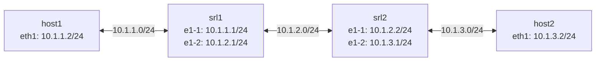
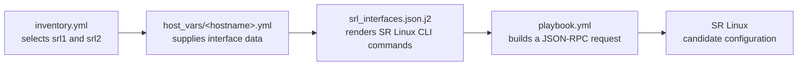
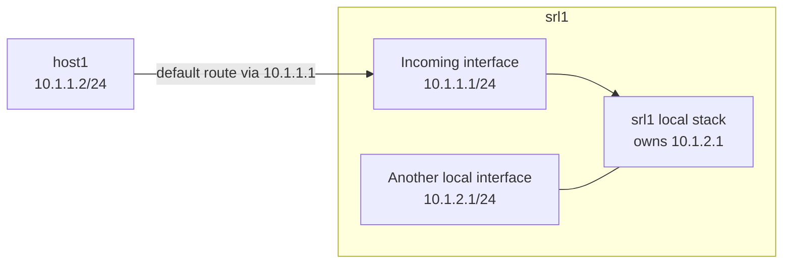

# IP Fundamentals: Addressing, ARP and First-Hop Routing

**Status:** Completed  
**Completed:** 3 November 2026  
**Validation:** 25/25 automated tests passed  
**Environment:** Ubuntu VM running through OrbStack

## Completion checklist

- [x] Exercise 1: Deployed lab, applied config, verified adjacent pings work
- [x] Exercise 2: Traced Jinja2 template for srl2, wrote generated commands
- [x] Exercise 3: Added loopback interface via Ansible
- [x] Exercise 4: Diagnosed and fixed admin-disabled interface
- [x] Exercise 5: Diagnosed and fixed subnet mismatch
- [x] Exercise 6: Diagnosed and fixed missing default route

## What I built

I deployed a four-node Containerlab topology containing two Nokia SR Linux routers and two Alpine Linux hosts. I then used Ansible, per-host variables and a Jinja2 template to configure the router interfaces through the SR Linux JSON-RPC API.

The topology used a different `/24` subnet for each data-plane link:



Interfaces sharing a subnet could communicate directly. Communication beyond a directly connected subnet required a route to a next-hop router, plus a valid return path.

## Ansible configuration flow

The inventory defined the router names. Ansible automatically associated each inventory hostname with the matching file under `host_vars`:

```text
inventory host srl1 -> host_vars/srl1.yml
inventory host srl2 -> host_vars/srl2.yml
```

The data flowed through the automation as follows:



The Jinja2 template loop generated the same command structure for every interface while substituting device-specific values:

```jinja2

"set / interface {{ iface.name }} admin-state enable",
"set / interface {{ iface.name }} subinterface 0 ipv4 address {{ iface.ipv4_address }}",
"set / network-instance default interface {{ iface.name }}.0",

```

The playbook used `connection: local` and `ansible.builtin.uri` to send the rendered command list to each router's JSON-RPC endpoint. It did not SSH to each node and scrape interactive CLI output.

## Exercise 1: Deploying and verifying the lab

I deployed the topology and applied the router configuration:

```bash
containerlab deploy -t topology/lab.clab.yml

cd ansible
ansible-playbook -i inventory.yml playbook.yml
```

I verified the adjacent links independently:

```text
host1 -> srl1    10.1.1.2 -> 10.1.1.1
srl1  -> srl2    10.1.2.1 -> 10.1.2.2
host2 -> srl2    10.1.3.2 -> 10.1.3.1
```

These tests proved connectivity on each directly connected subnet. They did not prove end-to-end routing between host1 and host2.

## Watching ARP learn a neighbour

Before sending local traffic, host1's ARP cache was empty:

```bash
docker exec clab-ip-fundamentals-host1 arp -n
```

I then pinged srl1's adjacent address:

```bash
docker exec clab-ip-fundamentals-host1 ping -c 3 10.1.1.1
```

After the ping, the ARP table contained a mapping from `10.1.1.1` to the MAC address of srl1's adjacent interface. Host1 had resolved the local Layer 3 address to the Layer 2 address needed on that link.

ARP is used for directly reachable neighbours. For a remote destination, a host instead resolves the MAC address of the selected next-hop gateway.

## Exercise 2: Tracing the Jinja2 template

I manually substituted the two interface entries from `host_vars/srl2.yml` into the Jinja2 loop. This produced the exact SR Linux CLI command list that the JSON-RPC request carried.

The completed output is in [`srl2-commands.txt`](./srl2-commands.txt).

This exercise made the separation between data and logic clear:

- `host_vars/srl2.yml` described what was different about srl2;
- the Jinja2 template described how any interface should be configured;
- the playbook rendered and delivered that configuration.

## Exercise 3: Adding a loopback

I added a loopback entry to `host_vars/srl1.yml`:

```yaml
- name: lo0
  ipv4_address: 10.10.10.1/32
  description: Loopback for management
```

The template did not need to change. Its existing loop rendered another set of interface commands, and Ansible applied the loopback to srl1.

I verified both the interface and its route-table presence:

```bash
docker exec -it clab-ip-fundamentals-srl1 \
  sr_cli -c "show interface lo0"

docker exec -it clab-ip-fundamentals-srl1 \
  sr_cli -c "show network-instance default route-table ipv4-unicast summary"
```

## Exercise 4: Admin-disabled interface

I deliberately disabled `ethernet-1/1` on srl1. The adjacent ping from host1 stopped responding, and SR Linux reported:

```text
ethernet-1/1 is down, reason port-admin-disabled
ethernet-1/1.0 is down, reason port-down
```

The connected `10.1.1.0/24` route was no longer active while the interface was down. Re-enabling the interface restored its operational state, the connected route and the adjacent ping.

The useful troubleshooting order was:

1. confirm the node is running;
2. inspect interface administrative state;
3. inspect interface operational state;
4. confirm the expected address and connected route;
5. test the adjacent peer.

## Exercise 5: Subnet mismatch

I replaced host1's correct address with the deliberately incorrect configuration:

```bash
docker exec clab-ip-fundamentals-host1 \
  ip addr add 10.1.1.200/30 dev eth1
```

A `/30` prefix leaves two host bits:

```text
32 total IPv4 bits - 30 network bits = 2 host bits
2^2 = 4 addresses per block
```

The block containing `10.1.1.200/30` is:

| Role | Address |
|---|---|
| Network | `10.1.1.200` |
| Usable host | `10.1.1.201` |
| Usable host | `10.1.1.202` |
| Broadcast | `10.1.1.203` |

The final octet still contains eight bits. With `/30`, six of those bits belong to the network prefix and only two remain for host values. srl1's `10.1.1.1/24` address therefore did not belong to host1's newly calculated local subnet.

I restored host1 to `10.1.1.2/24` and confirmed adjacent connectivity returned.

## Exercise 6: Missing default route

I removed host1's default route:

```bash
docker exec clab-ip-fundamentals-host1 ip route del default
```

The remaining route was only its directly connected subnet:

```text
10.1.1.0/24 dev eth1 scope link src 10.1.1.2
```

That explained the two different results:

- `10.1.1.1` remained reachable because it was local to `10.1.1.0/24`;
- `10.1.2.1` returned `Network unreachable` because no specific or default route matched it.

I restored the first-hop route:

```bash
docker exec clab-ip-fundamentals-host1 \
  ip route add default via 10.1.1.1 dev eth1
```



The packet did not hop from one srl1 interface to the other. Once it reached srl1 through `10.1.1.1`, the router recognised `10.1.2.1` as one of its own addresses and replied locally. The default route gave host1 a reachable first hop. Each router beyond that point would still need its own route, and the destination side would need a return path.

## Automated validation

I ran:

```bash
uv run \
  --project ../../.. \
  --group test \
  pytest tests/ -v
```

Result:

```text
25 passed in 139.71s
```

The supplied tests validated:

- Containerlab, Docker and Ansible availability;
- valid topology YAML with four nodes and three links;
- two SR Linux routers and two Linux hosts;
- pinned container images;
- Ansible inventory, playbook, template and host variables;
- valid Jinja2 template syntax;
- successful lab deployment and running containers;
- adjacent connectivity from each host to its router;
- router-to-router connectivity.

The complete result is available in [`02-tests-passed.png`](./02-tests-passed.png).

## Evidence

| File | Purpose |
|---|---|
| [`README.md`](./README.md) | Exercise explanations, diagrams and verification |
| [`srl2-commands.txt`](./srl2-commands.txt) | Manually rendered Jinja2 commands for srl2 |
| [`02-tests-passed.png`](./02-tests-passed.png) | Result of all 25 supplied tests |

The detailed working notes can remain private or be added after the subnet and wording corrections identified during review. The README is the concise, searchable public record.

## What I learned

This lesson connected several ideas that had previously felt separate:

- a subnet mask determines which destinations a host considers local;
- ARP resolves a directly reachable next hop to a MAC address;
- an interface can be configured but unusable because its administrative state is down;
- connected routes depend on usable interfaces;
- a default route provides a first hop rather than a complete end-to-end path;
- return routing matters as much as the outbound route;
- Ansible can separate device-specific data from reusable configuration logic.

The most useful change was in how I read a failed ping. I now check interface state, the source address and mask, the route selection and the return path instead of treating connectivity as a single yes-or-no condition.

## Attribution

The exercises and original lesson material are provided by [Drew Elliott's KubeCraft repository](https://github.com/drewelliott/kubecraft).

The lesson presents IP addressing and network automation in a concise, practical format, with break/fix exercises that make the routing decisions visible.

